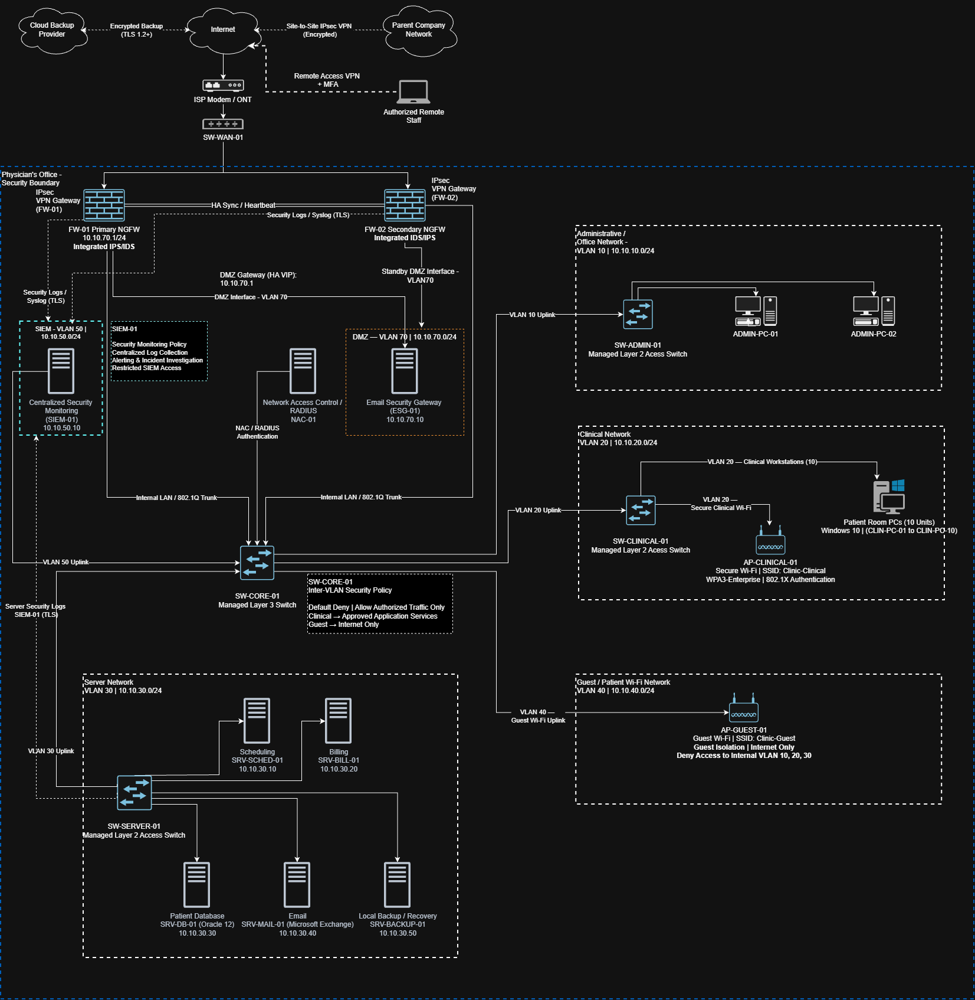

# Week 1 — Healthcare Network Boundary Design

## Project Overview

This project presents a proposed secure network architecture for a small physician's office. The objective is to protect electronic protected health information (ePHI), establish clear network security boundaries, and support daily healthcare operations.

The network is designed for two physicians, ten patient examination rooms, administrative workstations, and essential healthcare application servers.

**Project Status:** Logical design completed — implementation and security testing pending.

## Project Objectives

- Establish security boundaries between clinical, administrative, server, and guest networks.
- Protect sensitive patient information through network segmentation and access controls.
- Apply defense-in-depth principles using firewalls, IDS/IPS, and network access control.
- Secure remote access and communications with the parent organization.
- Incorporate centralized logging, security monitoring, and backup capabilities.
- Align proposed safeguards with NIST SP 800-53 security controls.

## Network Architecture

The proposed infrastructure is divided into six security zones:

| Network Segment | VLAN | Subnet |
|---|---|---|
| Administrative Network | 10 | 10.10.10.0/24 |
| Clinical Network | 20 | 10.10.20.0/24 |
| Server Network | 30 | 10.10.30.0/24 |
| Guest Wireless Network | 40 | 10.10.40.0/24 |
| Security Monitoring | 50 | 10.10.50.0/24 |
| Demilitarized Zone (DMZ) | 70 | 10.10.70.0/24 |

### Network Boundary Diagram

**Diagram Files:**

- [View Full Network Diagram (PDF)](healthcare-network-architecture.drawio.pdf)
- [View Editable Network Diagram (draw.io)](healthcare-network-architecture.drawio)

## Security Architecture

The proposed security architecture includes:

- **Next-Generation Firewalls:** Primary and secondary firewalls provide perimeter protection and high availability.
- **IDS/IPS:** Detects and helps prevent malicious network activity.
- **Network Segmentation:** VLANs separate clinical, administrative, guest, server, and security systems.
- **Network Access Control (NAC):** Supports authentication and authorization of network-connected devices.
- **Wireless Security:** WPA3-Enterprise and IEEE 802.1X protect clinical wireless access.
- **Demilitarized Zone (DMZ):** An email security gateway filters external email traffic before it reaches the internal Exchange server.
- **VPN Security:** IPsec site-to-site connectivity protects communication with the parent organization; remote staff use VPN and MFA.
- **Security Monitoring:** A centralized SIEM collects and analyzes security events.
- **Backup and Recovery:** Local and encrypted off-site backups support business continuity.

## Security Considerations

The network follows a proposed default-deny security policy, allowing only explicitly authorized communication between security zones.

The required Windows 10 workstations and Oracle Database 12 introduce potential risks associated with aging software platforms. These systems require appropriate security updates where available, restricted access, monitoring, and migration planning.

The architecture remains a logical design. Security controls have not yet been implemented or validated in a production environment.

## Standards and Frameworks

- **NIST SP 800-53 Rev. 4:** Security and Privacy Controls
- **NIST SP 800-207:** Zero Trust Architecture
- **ISO/IEC 27001:** Information Security Management
- **HIPAA Security Rule:** Protection of electronic protected health information

## Project Documentation

| Document | Description |
|---|---|
| [Architecture Decisions](architecture-decisions.md) | Security design decisions and justifications |
| Data Flow Security | Coming next |
| NIST Control Mapping | Coming next |

## Disclaimer

This project represents a hypothetical healthcare environment developed for educational and cybersecurity portfolio purposes. All network addresses, security configurations, and infrastructure components are part of a proposed design. No actual patient information is used.

